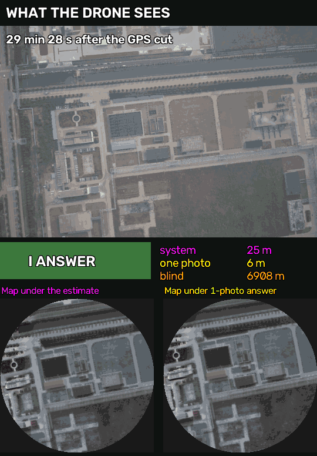
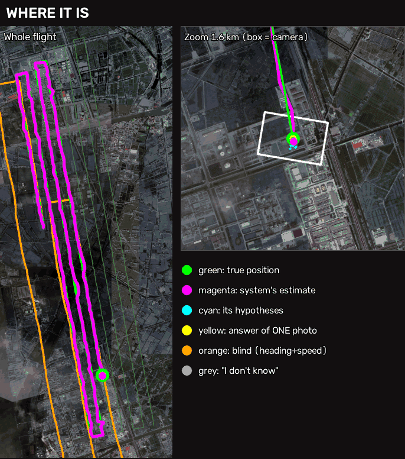
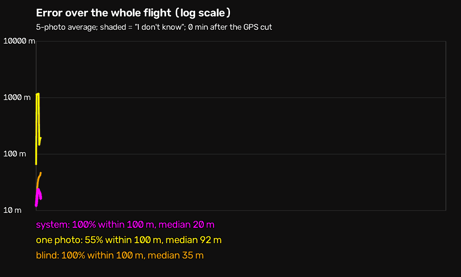
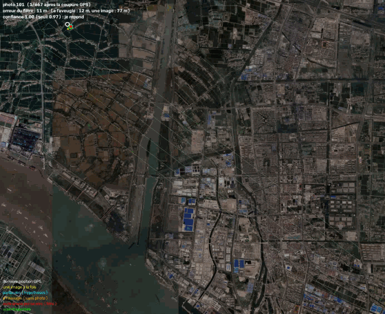

# GPS-less Localisation

**Where is a drone when the GPS is lost?** This project estimates the position of a fixed-wing drone flying at about 300–500 m from its downward-looking camera, its last known position and a satellite map stored on board. It must also say **"I don't know"** when it is not sure.

It assembles standard bricks (a pre-trained DINOv2 model, a particle filter, classical SIFT matching) and reports honestly what works and where it fails. No novelty is claimed.

<table>
<tr>
<td width="44%"></td>
<td width="56%"></td>
</tr>
</table>

*Second flight (validation, never used for training): 30 consecutive photos with a U-turn, 30 minutes after the GPS cut, played slowly. **Left:** what the drone sees and the three errors in metres. **Right:** the whole flight with the true path (green), the system's estimate (magenta), dead reckoning (orange), the answer of a single photo (yellow) and the filter's hypotheses (cyan).*

## Highlights

On a real flight never used for training (UAV-VisLoc flight 03):

- **Final system:** median error **29 m** and **98 %** of answers within 100 m, answering 78 % of the photos and saying "I don't know" for the rest. Without abstention: 35 m and 93 %.
- **Baselines:** dead reckoning alone has a median error of 2 830 m, one photo at a time 62 m.
- **Training matters:** fine-tuning DINOv2 takes single-photo accuracy from 36 % to 75 % within 100 m.
- **Main weakness:** camera tilt. At 20° only 51 % of photos are within 100 m.

## How it works

1. **Fingerprints.** The map is cut into overlapping 305 m disks. DINOv2 (ViT-B/14) turns each one into a *descriptor*, a short list of numbers.
2. **One photo, candidates.** The photo is rotated north-up with the known heading, cropped to a 305 m disk, turned into a descriptor and compared (cosine similarity) with all map disks.
3. **Training.** The last two DINOv2 blocks are fine-tuned (contrastive loss) on pairs *(recent photo, older map of the same place)* with random shifts, rotations, scale, blur and colour changes. Data: IGN orthophotos of Belfort (2017 map vs 2020 photos) mixed 50/50 with real flights from UAV-VisLoc. Train, validation and test are separated **by geographic zone**.
4. **Particle filter.** 2 000 hypotheses move along the known heading, are re-weighted by how well the photo matches the map, and resampled. A **physical constraint** rejects answers the drone could not have reached (it cannot fly 5 km in 46 s).
5. **SIFT hybrid.** SIFT rarely answers but is almost never wrong when it does, so it is added as a precise measurement.
6. **"I don't know".** The system abstains when too little of the particle cloud agrees on one place (threshold set on the validation flight).
7. **Heading self-calibration.** When SIFT recognises a photo it also measures the real camera orientation. Comparing it with the compass gives the compass bias, removed on the fly.

## Results

Real flight never used for training (UAV-VisLoc flight 03, 768 photos, 466 m altitude, China). The GPS is cut at 17 different moments (every 40 photos) and 150 photos (about 15 minutes) are tracked each time, averaged over 3 random seeds. The system only gets the last position and speed, the heading, the photos and the map. Brackets are 95 % confidence intervals (bootstrap over the GPS cuts).

| Method | Median error | Within 100 m | Within 500 m |
|---|---|---|---|
| Dead reckoning (heading + speed, no photos) | 2 830 m [2 096 ; 3 679] | 4 % | 18 % |
| One photo at a time, no context | 62 m [61 ; 64] | 74 % [72 ; 77] | 86 % [84 ; 88] |
| Particle filter (photo + heading) | 58 m [55 ; 60] | 88 % [86 ; 90] | 100 % |
| **+ SIFT (hybrid)** | **35 m [32 ; 39]** | **93 % [91 ; 94]** | **100 %** |
| + "I don't know" (answers 78 % of the photos) | **29 m [27 ; 30]** | **98 % [97 ; 99]** | 100 % |

On the second flight (04, validation, 687 photos tracked after one GPS cut): one photo at a time 68 % within 100 m, filter 97 %, hybrid 98 %, hybrid answering 88 % of the photos: 99.5 % within 100 m, median 29 m. No answer of the final system was further than 500 m from the truth in these tests.

Error over the whole second flight (687 photos, about 68 minutes without GPS), "I don't know" moments shaded:

### What the training buys (single photo, no filter, % within 100 m)

| Test | Pre-trained DINOv2-B | Fine-tuned (last 2 blocks) |
|---|---|---|
| Real flight 03 (China, vs Google map) | 36 % | **75 %** |
| Belfort countryside, 2017 map vs 2020 photos | 20 % | **70 %** |
| Val-d'Oise (other French region) | 21 % | **64 %** |

Robustness (final system, same real flight, one perturbation at a time, % within 100 m)

| Perturbation | Photo + heading | With SIFT | Comment |
|---|---|---|---|
| None | 90 % | 94 % | reference |
| Heading bias 10° / 20° / 45°, no correction | 75 % / 45 % / 9 % | 85 % / 45 % / 9 % | the model needs the heading |
| **Heading bias 10° / 20° / 45°, with self-calibration** | — | **95 % / 94 % / 94 %** | bias estimated from SIFT, then removed (3 seeds) |
| Heading noise up to 20° (no bias) | 86–90 % | 91–94 % | insensitive |
| Wrong altitude (view × 1.25 / × 1.5) | 87 % / 78 % | — | mild |
| Camera tilt 10° / **20°** | 77 % / **51 %** | — | **main remaining weakness** (never seen in training; 30°: 17 %) |
| Initial speed × 0.5 … × 1.5 | 87–90 % | 92–94 % | insensitive |
| Last GPS fix wrong by 300 m / 1 000 m | 88 % / 80 % | 93 % / 87 % | recovers |
| Photos missing: 6 of every 20 | 68 % | 76 % | degrades gracefully, no drift |
| Photos missing: 20 of every 60 (about 2.5 min) | 60 % (94 % within 500 m) | 61 % | the filter flies blind then recovers |

**Offline smoothing** (uses future photos, so not real-time): on flight 03 the median error goes from 32 m to **21 m**, 95 % to **99 %** within 100 m, and "backward steps" of the estimate (more than 30 m against the heading) drop from 6 to 2 on 3 108 photos. Neutral on the validation flight (98 % within 100 m before and after).

## Failure cases

A single photo is wrong on some stretches: rice fields **pale yellow in the photo** (ripe rice, Oct. 2018) but **dark green on the satellite map** (flooded), so the model picks another village up to 5.7 km away. The filter survives most of them because it trusts motion more than one ambiguous photo.

Early on, it sometimes believed that wrong answer at the first U-turn and jumped by kilometres (9 random runs out of 20 by more than 1 km). A drone cannot fly 5.7 km in 46 s, so answers farther than `max speed × elapsed time` are now rejected:

| Before (random jump at the U-turn) | After (physical constraint) |
|---|---|
|  |  |

*Final version, first flight. Green: truth. Magenta / red: estimate. Cyan: hypotheses. Yellow: single-photo answer. Orange: dead reckoning. White: last GPS fix. Grey circle: "I don't know".*

## Limitations

- **One real test flight** plus one validation flight. Other places, seasons or cameras are not shown (trained on France + 5 flights, tested on China).
- **The test flight was looked at several times** while fixing the filter. Each change was validated on a separate flight first and logged, but it is no longer a pristine one-shot.
- **The heading must be roughly right at the start, or recoverable by SIFT.** A bias of 20° or more breaks the system unless SIFT answers often enough (here 37–64 % of the photos). The calibration is shown as an offline simulation (`heading_calibration.py`), not in the default run.
- **Camera tilt of 20° or more** gives about 50 % within 100 m; the model never saw perspective in training.
- **The photo scale is assumed known.** Here it was calibrated on the same flight.
- **Precision is limited** by the 128 m grid of the map disks (about 90 m worst case); below that, SIFT and the filter do the work.
- **Initial position and speed come from the last GPS fixes.** Starting with no position at all is not covered.
- **Not tested on embedded hardware.** On the laptop (RTX 5070, 8 GB): about 11 ms per photo for the descriptor, 0.06 s for SIFT.
- **UAV-VisLoc maps come from Google** and are not redistributed.

## Data (not in this repository)

- **IGN BD ORTHO** (map and training in France): <https://data.geopf.fr/telechargement/resource/BDORTHO> — Licence Ouverte Etalab (credit: "BD ORTHO®, IGN"). One archive per department and edition (used: Belfort D090, 2017 and 2020; Val-d'Oise D095, 2018 and 2021).
- **UAV-VisLoc** (real flights and test): <https://github.com/IntelliSensing/UAV-VisLoc> — paper <https://arxiv.org/abs/2405.11936>. Full dataset (16.4 GB, 11 flights): <https://drive.google.com/file/d/1xYODANyilEMM3CfWh85APwkTHQeLTcCT/view?usp=sharing>.

Repository layout

| Path | What |
|---|---|
| `Project.md` | the original brief (in French) |
| `scripts/prep_ign_test.py` | builds "recent photo vs older map" tests from IGN editions |
| `scripts/prep_uav_test.py`, `calib_uav_gsd.py` | UAV-VisLoc flights as tests; photo scale calibration |
| `scripts/prep_train_data.py`, `train_dino.py` | training data (by zone) and fine-tuning of the last blocks |
| `scripts/sift_eval.py`, `dino_eval.py` | SIFT baseline and DINOv2 evaluation (Recall@K, error in metres) |
| `scripts/particle_filter.py` | the context filter, the SIFT hybrid, the smoothing, the animations |
| `scripts/confidence.py` | "I don't know": confidence, coverage / error curve |
| `scripts/heading_calibration.py` | in-flight compass-bias estimation from SIFT |
| `scripts/robustness.py` | heading, altitude, tilt, speed and GPS perturbations |
| `scripts/final_eval.py` | relocalisation gate, smoothing and confidence intervals |
| `scripts/compare_video.py` | the two slow animations of the second flight and the error-over-time GIF |
| `docs/*.gif` | animations used above (full videos are kept locally, not versioned) |

A detailed lab journal (in French) is kept locally in `experiments.md`: what was tried, what worked or failed, with measured numbers.

Python 3.12, PyTorch with CUDA 12.8 (RTX 5070 laptop GPU); dependencies in `requirements.txt`. Most scripts have `--help`.

